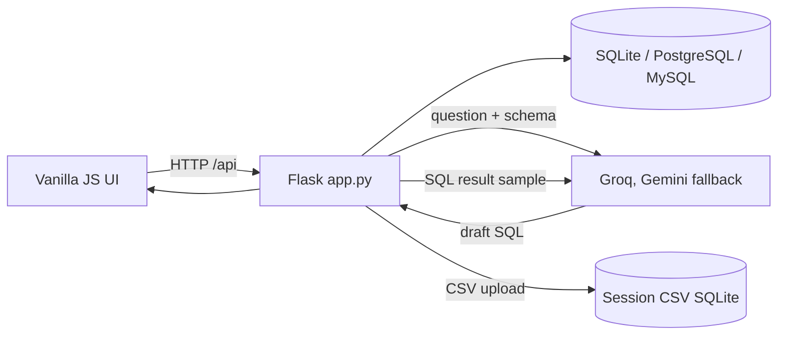

# Architecture

## Current implementation

`app.py` currently owns routes, provider calls, data access, demo initialization, and CSV processing. The browser page fragments are under `frontend/pages/`; navigation, API calls, charts, and result rendering live in `frontend/js/app.js`.

## Safety changes in progress

SQL execution is gated through SQLGlot parsing and AST shape checks, single-query/read-table checks, SQLite's authorizer, read-only PostgreSQL/MySQL transaction defaults, statement deadlines, and a SQL-level row cap. The parser tests and SQLite path pass in Lumiq's `.venv`; PostgreSQL/MySQL server integration has not yet been exercised.

Database connection configuration is stored in process memory and a random reference is kept in the signed cookie; this avoids placing passwords in the browser cookie but is only suitable for a single-process local prototype. A future multi-worker deployment needs an authenticated, server-side session/config store and strict lifecycle cleanup.

## Target modular boundaries

Extract route handlers, provider clients, schema catalog/adapters, SQL policy/executor, EDA, ML workflows, evaluation runner, and configuration into separate modules incrementally. Keep the existing API response contract while moving services, then version the API if behavior must change. Add retrieval only if a benchmark shows it improves schema selection or query correctness.
